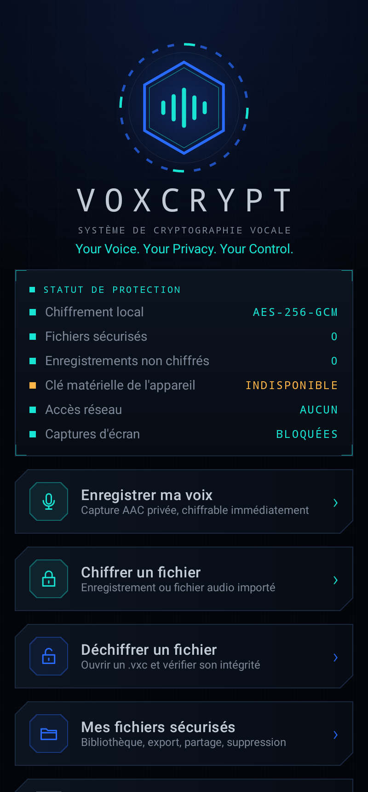
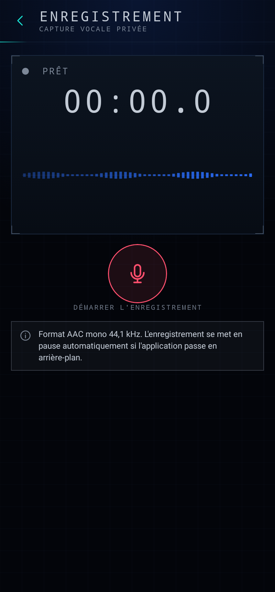
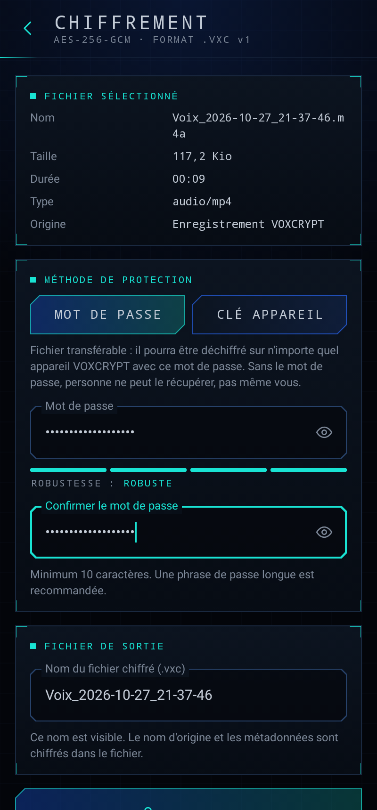
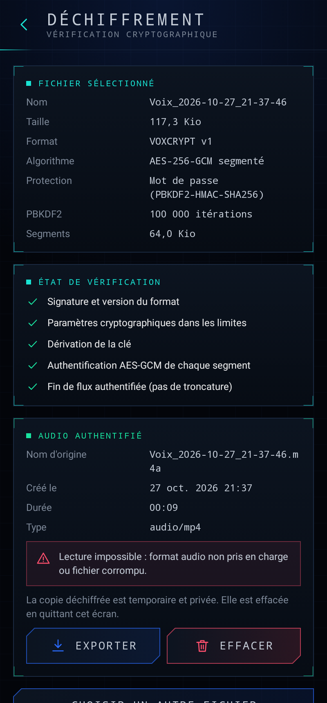

# VOXCRYPT

**Your Voice. Your Privacy. Your Control.**

Application Android native de cryptographie vocale : enregistrez votre voix,
chiffrez-la en AES-256-GCM, conservez des fichiers `.vxc` que seul le bon mot
de passe peut ouvrir, sur ce téléphone ou sur un autre.

Tout se passe sur l'appareil : pas de compte, pas de serveur, pas de
télémétrie. L'application ne demande même pas la permission Internet.

<p>




</p>

## Fonctionnalités

- **Enregistrement vocal** AAC/M4A : démarrer, pause, reprise, arrêt,
  chronomètre, visualisation du niveau sonore, réécoute, renommage,
  suppression. Pause automatique en arrière-plan.
- **Import** de fichiers audio existants (Storage Access Framework).
- **Chiffrement** AES-256-GCM segmenté, clé dérivée du mot de passe par
  PBKDF2-HMAC-SHA256 (600 000 itérations par défaut, configurable),
  relecture et authentification complètes avant destruction de la copie en
  clair.
- **Deux modes** : mot de passe (fichier transférable) ou clé de l'appareil
  (Android Keystore, local uniquement).
- **Déchiffrement vérifié** : signature, version et paramètres contrôlés
  avant la saisie du mot de passe ; audio restitué uniquement après
  authentification de tout le fichier ; messages distincts pour fichier
  tronqué, modifié, format non pris en charge, espace insuffisant.
- **Bibliothèque** : nom, date, taille, durée, état, méthode de protection ;
  déchiffrer, écouter, renommer, exporter, partager (fichier chiffré
  uniquement), supprimer, informations techniques.
- **Sécurité mobile** : captures d'écran bloquées, sauvegarde Android
  désactivée, fichiers temporaires privés et nettoyés, aucun secret journalisé.

## Démarrage rapide

```bash
./gradlew assembleDebug
adb install -r app/build/outputs/apk/debug/app-debug.apk
```

APK prêts à l'emploi : `dist/VOXCRYPT-1.0.0-debug.apk` (installable) et
`dist/VOXCRYPT-1.0.0-release-unsigned.apk` (à signer avec votre clé),
empreintes dans `dist/SHA256SUMS.txt`.

## Documentation

| Document | Contenu |
|---|---|
| [docs/BUILD_AND_INSTALL.md](docs/BUILD_AND_INSTALL.md) | Compilation (Android Studio, ligne de commande), signature release, installation sur smartphone, transfert de fichiers |
| [docs/ARCHITECTURE.md](docs/ARCHITECTURE.md) | Paquets, flux de données, stockage, cycle de vie |
| [docs/FORMAT_VXC.md](docs/FORMAT_VXC.md) | Spécification binaire du format `.vxc` v1 et règles d'évolution |
| [docs/CRYPTO_DESIGN.md](docs/CRYPTO_DESIGN.md) | Conception cryptographique et justifications |
| [docs/SECURITY.md](docs/SECURITY.md) | Mesures de sécurité mobile et **limites connues** |
| [docs/TEST_REPORT.md](docs/TEST_REPORT.md) | Résultats de tests réellement observés |

## Tests

```bash
./gradlew test                       # 134 tests JVM : moteur, stockage, interface (Robolectric)
./gradlew connectedDebugAndroidTest  # tests sur appareil : micro, Keystore, lecture
```

Le format est aussi vérifié par un décodeur Python indépendant :
`python3 tools/vxc_decrypt.py fichier.vxc sortie.m4a`.

## Pile technique

Kotlin 2.1, Jetpack Compose (Material 3), MVVM, coroutines, MediaRecorder,
MediaPlayer, `javax.crypto`, Android Keystore. `minSdk` 26 (Android 8.0),
`targetSdk` 35 (Android 15).
